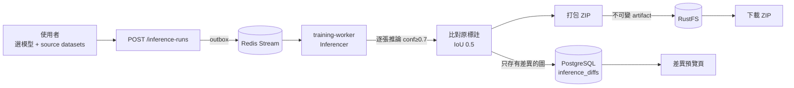
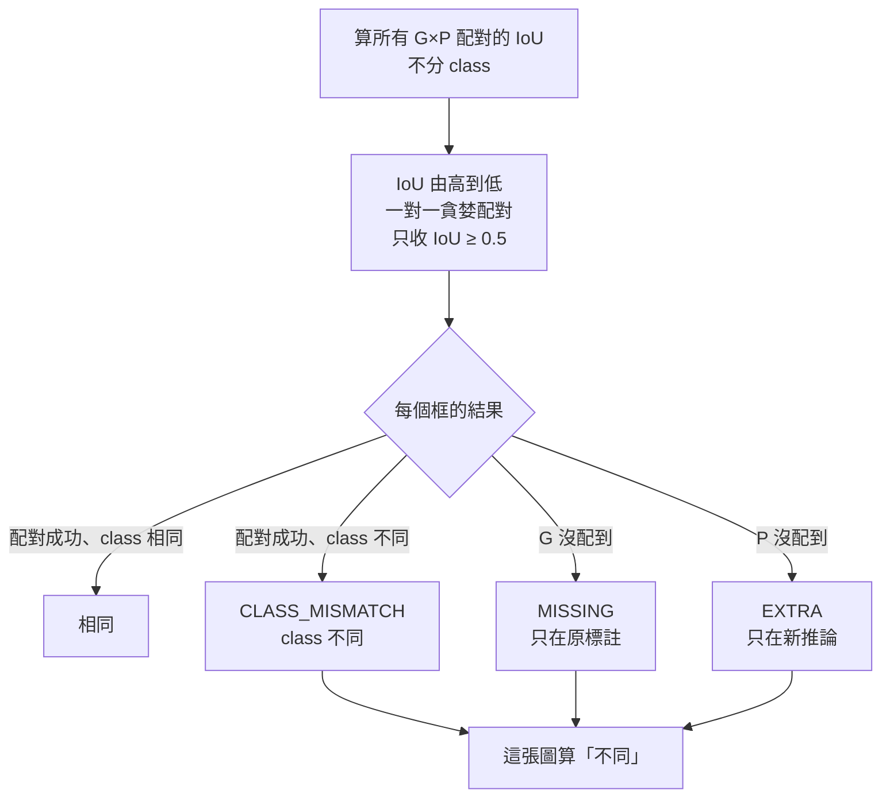

# 模型推論比對（單機版）實作規劃

> 狀態：第一至三階段完成（2026-10-14），未部署
> 範圍：只在 Model Training Platform（MTP）內完成 **Inference → Compare → Download**。
> 回填 Dataset Manager（DM）等跨系統串接**不在本次範圍**，之後另外討論（見 §9）。

## 1. 目標

用新訓練的模型重新推論 source dataset，找出「模型結果和原本標註不一樣」的圖片，讓使用者：

1. 在 MTP 裡預覽差異（原標註 vs 新推論）
2. 只把有差異的圖片打包成 ZIP 下載

## 2. 規格

| 項目 | 決定 |
|---|---|
| 輸入 | 一個已註冊模型 + 一個或多個同 dataset type 的 source dataset |
| Task type | DETECT（第一階段；OBB 之後再加） |
| Confidence | 推論結果只保留 **conf ≥ 0.7** |
| 比對 IoU | **0.5** |
| 判定不同 | 一張圖只要有**任何一個**框對不上就算不同 |
| 下載內容 | 只包有差異的圖片；`images/` + `labels/`（新推論）+ `classes.txt` |
| 下載格式 | ZIP，每個 source dataset 一個 |
| Source dataset | 唯讀，不寫任何檔案（鐵則 2） |

conf 與 IoU 門檻存在每次 run 上（快照），之後若要開放調整，不影響舊 run 的結果解讀。

## 3. 整體流程



## 4. 比對規則

每張圖：原標註框集合 G，推論框集合 P（已濾掉 conf < 0.7）。



- 配對**不分 class**：同一個位置 class 標錯要被抓成 CLASS_MISMATCH，而不是一個 MISSING 加一個 EXTRA。
- 原標註無效的行（格式錯、class index 超出範圍）沿用 scan 的判定，該圖記為 `LABEL_INVALID`，算「不同」。
- 沒有 label 檔的圖 = 原標註為空。

## 5. 資料模型（migration `011_inference_runs.sql`）

只新增，不改 `001`。

```
inference_runs
  id, name, description
  model_id, model_checksum_snapshot
  conf_threshold (0.7), iou_threshold (0.5)
  device
  status: QUEUED | RUNNING | COMPLETED | PARTIALLY_FAILED | FAILED | CANCELLED | STOPPING | STOPPED
  dataset_count, completed_count, failed_count
  created_by_user_id, created_at, queued_at, started_at, finished_at
  stop_requested_at, stop_requested_by_user_id, stopped_at

inference_run_datasets            -- 一個 run × 一個 source dataset = 一個 job
  id, inference_run_id, source_dataset_id
  source_scan_id_snapshot          -- 推論當下的 scan，判斷來源後來是否變過
  status: QUEUED | RUNNING | COMPLETED | FAILED | CANCELLED | STOPPING | STOPPED
  image_count, processed_count, diff_image_count
  missing_count, extra_count, class_mismatch_count
  zip_artifact_id                  -- INFERENCE_DIFF_ZIP
  failure_code, failure_message, started_at, finished_at

inference_diffs                   -- 只存「不同」的圖
  id, inference_run_dataset_id
  image_relative_path
  original_boxes jsonb             -- 原標註快照
  predicted_boxes jsonb            -- 含 conf
  matches jsonb                    -- 每個框的判定與配對對象
  missing_count, extra_count, class_mismatch_count, label_invalid
  UNIQUE (inference_run_dataset_id, image_relative_path)
```

狀態用語沿用 benchmark（`benchmark_run_status` / `benchmark_evaluation_status`），前端 StatusBadge 與 stop / retry 邏輯可直接套用。

其他：
- `job_type` enum 加 `INFERENCE`。
- `artifact_types` 加 `INFERENCE_DIFF_ZIP`（owner：`INFERENCE_RUN_DATASET`，`.zip`）；`resource_types` 視需要加對應項。
- 權限：worker_role 可寫三張表，backend_role 可讀寫 runs，readonly 可讀。比照 benchmark 的 grants。

**為什麼存原標註快照**：預覽頁要顯示「推論當下」的比對結果。若只讀磁碟上的現有 label，DM 之後重新 archive 會讓預覽和 ZIP 對不起來。圖片本身仍從 source 讀（不複製），若 scan 已變更，頁面顯示警告。

**為什麼只存不同的圖**：正式環境 898,444 張，大部分應該相同。相同的只記數量，不存列。

## 6. 各層改動

### 6.1 Worker（training-worker）

新增 `inferencer.py`，與 `benchmarker.py` 同模式（heartbeat、GPU 配置、stop、assignment token）。

1. 用 `model_cache.fetch_model_file` 取模型，比對 checksum 快照。
2. 讀 source dataset 的 images / labels / classes（唯讀）。
3. 分批 `model.predict(conf=0.7)`，每批完成後：比對 → 寫入 `inference_diffs` → 更新 `processed_count`（前端進度條）。
4. 全部推論完，用 Python 內建 `zipfile` 打包差異圖，上傳 RustFS，建 `INFERENCE_DIFF_ZIP` artifact。
5. 最後完成的 dataset job 負責收尾整個 run 的狀態（同 benchmark）。

ZIP 內容：

```
<source dataset 名>_<run 名>.zip
├── images/            有差異的原圖（從 source 複製）
├── labels/            新推論結果，YOLO 格式，不含 conf 欄
├── classes.txt        模型的 class 名稱
└── diff_summary.csv   檔名, missing, extra, class_mismatch
```

`worker.py` 的 `_handle` 加上 `job.inference.dispatch` 事件。

### 6.2 Class 對應

模型 class 名稱和 source dataset class 名稱必須**依名稱完全一致**（同順序）。名稱對應（重新映射 index）先不做，列為待確認。

**由 worker 檢查，不在建立 run 時檢查**：`models` 表只記 `class_count`，class 名稱只在 .pt 檔裡。worker 載入模型後比對，不一致就把該 dataset job 標 FAILED（`failure_code = INFERENCE_CLASS_MISMATCH`），訊息列出差異。

### 6.3 API（`apps/api/src/inference/`）

| Method | Path | 說明 |
|---|---|---|
| POST | `/inference-runs` | 建立 run；驗證模型、datasets、class；寫 run + outbox（同一 transaction）+ audit |
| GET | `/inference-runs` | 列表 |
| GET | `/inference-runs/:id` | 詳情 + 每個 dataset 的進度與統計 |
| POST | `/inference-runs/:id/stop` | 停止 |
| POST | `/inference-runs/:id/retry` | 重跑失敗的 dataset |
| GET | `/inference-runs/:id/datasets/:rdId/diffs` | 差異圖列表（分頁、依差異類型篩選、排序） |
| GET | `/inference-runs/:id/datasets/:rdId/diffs/:diffId` | 單張圖的原標註 / 推論 / 配對結果 |
| GET | `/inference-runs/:id/datasets/:rdId/download` | 回傳 ZIP 的 presigned URL（沿用 artifacts 的下載方式） |

圖片沿用 `GET /source-datasets/:id/samples/:filename/image`。共用型別與錯誤碼加在 `packages/shared-types`。

### 6.4 Scheduler

比照 benchmark：stale execution 回收、retry。若 benchmark 的邏輯可直接套用 `job_type`，只需加 enum 值。

### 6.5 前端

**新頁面 `InferenceRunsPage` + `InferenceRunDetail`**，側欄加「Inference」。

- 建立 dialog：選模型 → 只列出同 type、class 相容的 source datasets（多選）→ 選 device → 送出。
- Run 詳情：每個 dataset 一列，顯示進度、差異圖數量、三種差異的數量、**Download ZIP** 按鈕、**Compare** 入口。

**Compare 頁（參考 DM compare）**

```
┌─────────────────────────────────────────────────────────────┐
│ 篩選：[全部 ▾] MISSING / EXTRA / CLASS_MISMATCH   排序 ▾      │
├──────────────────────────┬──────────────────────────────────┤
│  原標註                   │  新推論 (conf ≥ 0.7)              │
│  ┌────────────────────┐  │  ┌────────────────────┐          │
│  │  ▭ 綠：相同         │  │  │  ▭ 綠：相同         │          │
│  │  ▭ 紅：MISSING      │  │  │  ▭ 藍：EXTRA        │          │
│  │  ▭ 橘：class 不同   │  │  │  ▭ 橘：class 不同   │          │
│  └────────────────────┘  │  └────────────────────┘          │
│  同步縮放 / 平移           │  框上顯示 class + conf             │
├──────────────────────────┴──────────────────────────────────┤
│ ◀ [縮圖][縮圖][縮圖][縮圖][縮圖] ▶       12 / 3,481          │
└─────────────────────────────────────────────────────────────┘
```

| 沿用 DM compare 的概念 | MTP 要新增的 |
|---|---|
| 左右兩個 canvas、同步縮放 / 平移 | 每個框依判定上色 |
| 縮圖列、鍵盤左右切換 | 依差異類型篩選、依差異數排序 |
| | 點框時標出另一側的配對對象 |
| | 來源已變更的警告 |

畫框可沿用 `DatasetPreviewPanel.tsx` 的 `drawOverlay`。DM 是另一個 repo（Next.js），只參考互動設計，不搬程式碼。

## 7. 開發階段

| 階段 | 內容 | 完成時可驗證 |
|---|---|---|
| 1 | migration 011、shared-types、`POST/GET /inference-runs`、outbox dispatch | 建 run 後 job 進到 Redis |
| 2 | `Inferencer`：推論 + 比對 + 寫 `inference_diffs` + 進度；scheduler 回收中斷的 job（從第 5 階段提前） | DB 裡有正確的差異列；用小 dataset 人工核對 |
| 3 | ZIP 打包 + artifact + 下載端點；Runs 列表 / 詳情頁 | 下載的 ZIP 內容正確，可直接匯入 DM 當新 dataset |
| 4 | Compare 頁 | 差異預覽與 DB 一致 |
| 5 | stop / retry API、`qa/run.mjs` 加 smoke | 三個瀏覽器引擎都過 |

每個階段都可單獨部署。

## 8. 待確認

- [ ] 輸出只要 ZIP 下載，還是也要寫一份到 NAS 資料夾？（先前討論過 A+B；本次範圍先只做 ZIP）
- [ ] class 名稱不一致時：一律擋下，還是允許依名稱重新映射？
- [ ] conf 0.7 / IoU 0.5 是固定值，還是建立 run 時可調？
- [ ] ZIP 佔 RustFS 空間（差異圖是原圖複製，單張 4–581 KB）。是否需要保留期限或手動釋放？artifact 不可由使用者刪除（鐵則 3），若要釋放需另訂系統層的清理規則。
- [ ] 誰能建立 inference run（所有登入者 / 只有 ADMIN）？
- [ ] 要不要同時支援已註冊的 training dataset 當輸入？

## 9. 不在本次範圍

- 回填 DM（unarchive、匯入新版本、啟用）。DM 目前的版本模型會讓只匯入差異圖的新版本在啟用時被舊標註覆蓋（`carryJobsToVersion` 對已完成 job 用 `ON CONFLICT DO UPDATE`），且 unarchive 會刪掉 MTP 的 source 資料夾。需要和 DM 一起設計，之後再討論。
- 用修正後的標註覆蓋 source dataset 建 training dataset。
- OBB、segmentation 等其他 task type。
