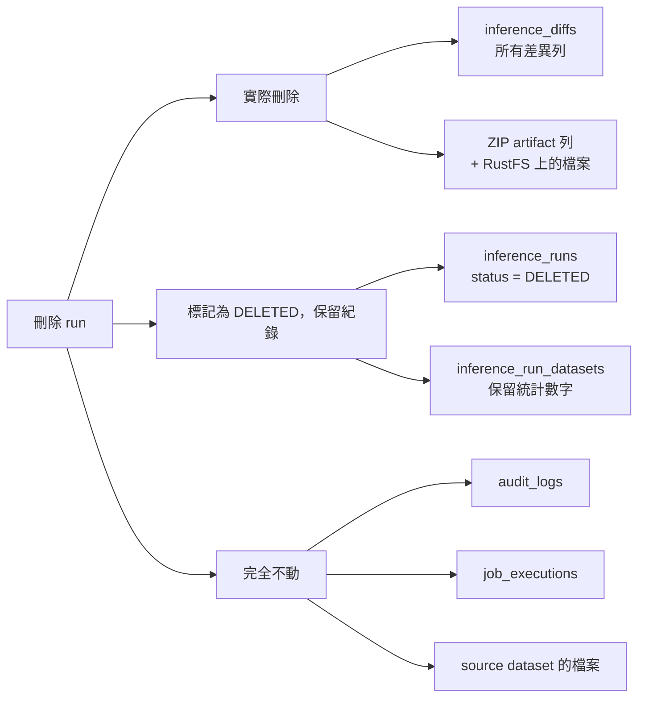

# 推論 run 刪除：規劃

> 狀態：規劃中（2026-10-14），待確認 §6 後開工
> 相關：`docs/inference-compare-plan.md`

## 1. 目標

讓使用者刪除不需要的推論 run（例如測試用的、模型選錯的），並**釋放它佔用的空間**。正式機目前唯一的 run `test` 就有 1,293 筆差異資料和一個 363 MB 的 ZIP。

## 2. 刪什麼、留什麼



| 項目 | 處理 | 原因 |
|---|---|---|
| `inference_diffs` | **實際刪除** | 量大（每張不同的圖一列），是推論結果，不是紀錄 |
| ZIP（`INFERENCE_DIFF_ZIP` artifact 與 RustFS 物件） | **實際刪除** | 佔空間的主要來源；這正是刪除的目的 |
| `inference_runs` | **軟刪除**：`status = DELETED`、記下 `deleted_at` / `deleted_by_user_id` | `job_executions`、audit、通知都用 id 指向它，保留才不會變成孤兒 |
| `inference_run_datasets` | 保留（只有統計數字，很小） | 同上，Jobs 頁的歷史紀錄要能查到名稱 |
| `audit_logs` | 不動，新增一筆 `INFERENCE_RUN_DELETED` | 鐵則 4：audit 只能新增 |
| Source dataset | 不動 | 鐵則 2：source 唯讀 |

這與現有的**刪除模型**作法一致（`ModelsService.deleteModel`）：主資料軟刪除，模型轉換產生的 artifact 則實際刪除資料列和物件。程式註解已將其標為 AGENTS.md 鐵則 3（artifact 不可變、不可由使用者刪除）的**局部例外**；推論 ZIP 會是第二個例外，需要確認（§6）。

## 3. 規則

- **只能刪已結束的 run**：`COMPLETED`、`PARTIALLY_FAILED`、`FAILED`、`CANCELLED`、`STOPPED`。進行中的要先按 Stop，等它停下來再刪；避免 worker 寫到一半資料被刪。
- **刪掉後**：
  - 列表、詳情、比對頁、ZIP 下載都看不到；詳情回 404。
  - Retry、Stop 都會拒絕。
  - Jobs 頁不顯示它的 job。
- **名稱可以重用**：刪除後，同一個 dataset type 下可以再建立同名的 run。原本的唯一索引改成只限未刪除的 run。
- **RustFS 物件的刪除放在資料庫交易之後**：先 commit，再刪物件，失敗只記 log，不回滾。和刪除模型一樣，寧可留下孤兒檔案，也不要資料庫指向不存在的檔案。

## 4. 改動清單

### 4.1 DB：migration `014_inference_run_delete.sql`

```
ALTER TYPE app.inference_run_status ADD VALUE 'DELETED';
ALTER TABLE app.inference_runs
  ADD COLUMN deleted_at timestamptz,
  ADD COLUMN deleted_by_user_id uuid REFERENCES app.users(id);
DROP INDEX app.uq_inference_runs_dataset_type_name;
CREATE UNIQUE INDEX uq_inference_runs_dataset_type_name
  ON app.inference_runs (dataset_type_id, lower(name)) WHERE deleted_at IS NULL;
```

索引條件用 `deleted_at IS NULL`，不用 `status <> 'DELETED'`：PostgreSQL 不允許在新增 enum 值的同一個交易裡使用它。backend_role 已經有 `inference_diffs` 的 DELETE（012）和 `artifacts` 的 DELETE（001），不需要新權限。

### 4.2 API

- `DELETE /inference-runs/:id`：在同一個交易裡做這些事：
  1. 鎖住 run 並檢查狀態（只能是已結束的）。
  2. 刪除 diffs。
  3. 刪除 ZIP 的 artifact 列。
  4. 把 `zip_artifact_id` 設為 null。
  5. 把 run 標成 DELETED。
  6. 寫入 audit，before 快照包含差異張數和 ZIP 大小。

  交易 commit 之後，再刪 RustFS 上的物件。
- **列表、詳情、比對頁、diffs 的 endpoint**：過濾掉 DELETED 的 run。
- **Retry 和 Stop**：DELETED 不在允許的狀態裡，本來就會拒絕；補上對應的錯誤訊息即可。
- **Jobs 頁的 `INFERENCE_Q`**：排除已刪除 run 的 job。
- **新錯誤碼**：`INFERENCE_NOT_DELETABLE`（run 還在進行中）。
- **權限**：見 §6。

### 4.3 前端

- run 詳情頁標題列和列表卡片，各加一個紅色 **Delete** 按鈕，只對已結束的 run 顯示。
- 確認視窗寫清楚會刪掉什麼，例如：「會刪除 1,293 張差異圖的比對結果和 363 MB 的 ZIP，無法復原。」
- 刪除後回到列表。如果當時正開著那個 run 的詳情或比對頁，就關掉。

### 4.4 QA

- `qa/run.mjs` 最後加一步：刪除 QA 建立的推論 run，確認它從列表消失、詳情回 404。
- 用 API 手動測試：
  - 刪除進行中的 run，應該被拒絕。
  - 刪除後，diffs、ZIP 的 artifact 列和 RustFS 物件都已經不在。
  - 刪除後可以用同一個名稱建新的 run。
  - audit 有寫入。

## 5. 開發順序

| 步驟 | 內容 | 驗證 |
|---|---|---|
| 1 | migration 014 + DB 型別 | 全新 DB 與既有 DB 都能套用 |
| 2 | API：DELETE、過濾、Jobs 頁 | API 測試（§4.4） |
| 3 | 前端按鈕與確認視窗 | 瀏覽器實測 |
| 4 | QA smoke 加刪除步驟 | 三個瀏覽器都通過 |

預估半天。

## 6. 待確認

- [ ] **同意把推論 ZIP 列為 AGENTS.md 鐵則 3 的局部例外**（與刪除模型時刪除轉換檔相同的作法）。不同意的話，只能做「隱藏」：資料和 ZIP 都留著，不會釋放空間。
- [ ] **誰可以刪**：
  - (a) 只有 ADMIN：和刪除模型、刪除訓練資料集一致。
  - (b) ADMIN 和建立該 run 的人。

  建議 (b)，推論 run 多半是使用者自己建來看結果的。
- [ ] **要不要批次刪除**：在列表勾選多個一起刪。第一版建議先不做。
